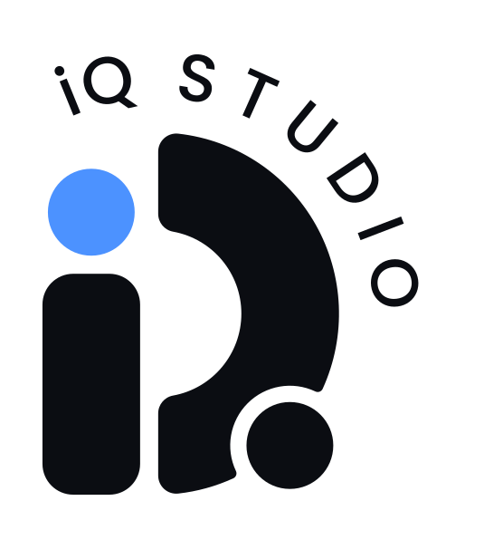

<!--
 Copyright (c) 2025 Innodisk Corp.

 This software is released under the MIT License.
 https://opensource.org/licenses/MIT
-->
# iQ-Studio

   
  
<picture>
      <source media="(prefers-color-scheme: dark)" srcset="./docs/fig/iQ-badge-white-studio.svg">
      <source media="(prefers-color-scheme: light)" srcset="./docs/fig/iQ-badge-ink-studio.svg">
      
    </picture>

   

  <h1 align="center"><em><strong>Show Performance, Spark Imagination.</strong></em></h1>

  <h3 align="center">It helps users quickly understand, explore, and prototype ideas by showcasing the platform’s performance and capabilities—inspiring innovation through hands-on experience.</h3>

  <a href="https://iqstudio.innodisk.com"><strong>🌐 Website</strong></a>
  &nbsp;·&nbsp;
  <a href="https://iqstudio.innodisk.com/architecture.html"><strong>🧱 Architecture</strong></a>

> [!NOTE]
> iQ-Studio is suitable for a range of products developed based on the [Innodisk Qualcomm Dragonwing SoC](https://www.innodisk.com/en/news/innodisk-unveils-ai-on-dragonwing-computing-series).

# Performance

**Measured, not claimed.** With 9 channels of 1080p video, iQS-Streampipe on the EXMP-Q911 (Qualcomm IQ-9075) holds **28.41 FPS per channel**, against 7.58 on a Jetson AGX Orin 32GB, about **3.7×** (same YOLOv10n INT8 model; one workload, not a general ranking). The scripts, configuration, and raw data are in [Benchmarks](./benchmarks/iq-9075/multi-stream/iqs-streampipe/README.md) so you can reproduce it on your own device.

# Demos

Pick a demo, run one command, and see the result on screen. New to the platform? Power on and flash it first with the [Starting Guides](./tutorials/starting-guides/README.md). Each demo page lists what you need and how to install.

| Demo | Launch command | Requires |
| :--- | :--- | :--- |
| [iQS-VLM](./tutorials/applications/iqs-vlm/README.md) | `iqs-launcher --autotag iqs-vlm-demo` | BSP v2.5.0+ (`v0.0.12`+), UVC Camera, monitor |
| [iQS-QVADK](./tutorials/applications/iqs-qvadk/README.md) | `iqs-launcher --autotag iqs-qvadk` | BSP v2.5.0+, monitor |
| [iQS-Streampipe](./tutorials/applications/iqs-streampipe/README.md) | `iqs-launcher --autotag iqs-streampipe` | BSP v2.5.0+ (`v0.0.12`+), monitor |
| [iQS-YOLOv10n](./tutorials/applications/iqs-yolov10n/README.md) | `iqs-launcher --autotag iqs-yolov10n` | BSP v2.5.0+ (`v0.0.11`+) |

## iQS-VLM
A vision-language model, powered by [GenieX](https://github.com/qualcomm/GenieX), describes a live UVC Camera feed on the monitor in real time.

## iQS-QVADK
Many 1080p channels at once, with several AI models running on every channel on the Qualcomm NPU of a single device. Defaults to PPE detection.

## iQS-Streampipe
A multi-stream video pipeline (GStreamer and OpenCV) that runs object detection on UVC Cameras or video files and shows the composite output.

## iQS-YOLOv10n
YOLOv10n INT8 inference on GPU and NPU, with the same model compared across platforms.

For all demos and their details, see [Demos](./tutorials/applications/README.md).

# Explore Documentation & Resources

iQ-Studio resources are grouped into categories based on functionality:

<table>
  <col style="width: 30%">
  <col style="width: 30%">
  <col style="width: 40%">
  <thead>
    <tr>
      <th>Categories</th>
      <th>Description</th>
      <th>Topic</th>
    </tr>
  </thead>
  <tbody>
    <tr>
      <td><a href="./tutorials/starting-guides/README.md">Starting Guides</a></td>
      <td>Power on, flash, and update your device before running anything else.</td>
      <td>
        <ul>
          <li><a href="./tutorials/starting-guides/iq-9075/README.md">Q911 Quick Start Guide</a></li>
          <li><a href="./tutorials/starting-guides/flash-image/README.md">Q911 Image Flashing Guide</a></li>
          <li><a href="./tutorials/starting-guides/ota/README.md">Qualcomm OTA Guide</a></li>
        </ul>
      </td>
    </tr>
    <tr>
      <td><a href="./tutorials/avl/README.md">AVL(Approved Vendor List)</a></td>
      <td>Innodisk camera modules, camera adapter boards, and embedded peripheral modules validated on the platform, with steps to verify that each driver starts correctly.</td>
      <td>
        <ul>
          <li><a href="./tutorials/avl/gmsl-camera/README.md">GMSL Camera</a></li>
          <li><a href="./tutorials/avl/mipi-camera/README.md">MIPI Camera</a></li>
          <li><a href="./tutorials/avl/camera-adapter-boards/README.md">Camera Adapter Boards</a></li>
          <li><a href="./tutorials/avl/embedded-peripheral/README.md">Embedded Peripheral Modules</a></li>
        </ul>
      </td>
    </tr>
    <tr>
      <td><a href="./tutorials/applications/README.md">Demos</a></td>
      <td>Ready-to-run demos: pick one, run a single command, and see the inference result on screen.</td>
      <td>
        <ul>
          <li><a href="./tutorials/applications/iqs-vlm/README.md">iQS-VLM</a></li>
          <li><a href="./tutorials/applications/iqs-streampipe/README.md">iQS-Streampipe</a></li>
          <li><a href="./tutorials/applications/iqs-yolov10n/README.md">YOLOv10n INT8 Inference on GPU and NPU</a></li>
          <li><a href="./tutorials/applications/iqs-qvadk/README.md">iQS-QVADK</a></li>
        </ul>
      </td>
    </tr>
    <tr>
      <td><a href="./tutorials/model-deploy/README.md">Model Deploy</a></td>
      <td>Bring your own model: quantize, convert, validate, and run it on the device with iQ-Foundry, plus a guide for choosing the model configuration.</td>
      <td>
        <ul>
          <li><a href="./tutorials/model-deploy/cv/yolo26/README.md">Model Deploy: How to Convert, Optimize, and Perform Inference with YOLO26 Models</a></li>
          <li><a href="./tutorials/model-deploy/iqf-model-guide/README.md">iQ-Foundry Model Selection Guide</a></li>
        </ul>
      </td>
    </tr>
    <tr>
      <td><a href="./tutorials/sdks/README.md">SDKs</a></td>
      <td>Customize the demos after you run them: chat with the VLM, change the model and video source, or run your own LLM/VLM.</td>
      <td>
        <ul>
          <li><a href="./tutorials/sdks/iqs-vlm/README.md">iQS-VLM: Chat with the VLM through Open WebUI</a></li>
          <li><a href="./tutorials/sdks/iqs-streampipe/README.md">iQS-Streampipe: How to Change the Custom Model and Video Source</a></li>
          <li><a href="./tutorials/sdks/iqs-qvadk/README.md">iQS-QVADK: How to Switch and Run the Applications</a></li>
          <li><a href="./tutorials/sdks/geniex/README.md">GenieX: Run Your Own LLM/VLM on the Platform</a></li>
        </ul>
      </td>
    </tr>
    <tr>
      <td><a href="./benchmarks/README.md">Benchmarks</a></td>
      <td>Reproducible measurements of AI models and multi-stream scaling on IQ-9075 and IQ-8275, with scripts and configuration included.</td>
      <td>
        <ul>
          <li><a href="./benchmarks/iq-9075/multi-stream/iqs-streampipe/README.md">IQ-9075: iQS-Streampipe Multi-stream Inference</a></li>
          <li><a href="./benchmarks/iq-9075/multi-stream/iqs-qvadk-scaling/README.md">IQ-9075: iQS-QVADK Multi-stream Scaling</a></li>
          <li><a href="./benchmarks/iq-9075/model/perception_model/README.md">IQ-9075: Perception AI Benchmark</a></li>
          <li><a href="./benchmarks/iqf-models/README.md">IQ-9075: iQ-Foundry Model Benchmark</a></li>
          <li><a href="./benchmarks/iq-8275/multi-stream/iqs-streampipe/README.md">IQ-8275: iQS-Streampipe Multi-stream Inference</a></li>
        </ul>
      </td>
    </tr>
  </tbody>
</table>

# In the News

Media coverage, deployments, and ecosystem case studies: see [In the News](https://iqstudio.innodisk.com/in-the-news.html).

# Related Repositories

iQ-Studio integrates with several sibling repositories. Each owns a specific layer of the platform stack.

- [InnoIPA/meta-iQ__manifest](https://github.com/InnoIPA/meta-iQ__manifest) — Yocto-based BSP baseline for the platform.
- [InnoIPA/iQ-Cam__manifest](https://github.com/InnoIPA/iQ-Cam__manifest) — Camera driver patches consumed by the AVL tutorials.
- [InnoIPA/iQ-Foundry](https://github.com/InnoIPA/iQ-Foundry) — End-to-end model quantization and on-device validation for custom models.

# Changelog

Please refer to the [Changelog](./docs/changelog.md) for all updates.

# License

This project is licensed under the MIT License. See [LICENSE](./LICENSE) for details.
