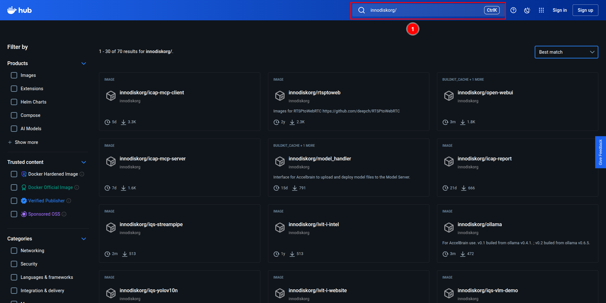

<!--
 Copyright (c) 2025 Innodisk Corp.

 This software is released under the MIT License.
 https://opensource.org/licenses/MIT
-->

# How to Use iqs-launcher

`iqs-launcher` is the execution entry point for every application shipped with iQ-Studio. Install it first with `git clone` and `./install.sh`. It then finds the Docker image for the application and runs it. When the platform cannot download the image from Docker Hub, you can provide the image as a `.tar` archive instead.

For a single end-to-end demo command, see the [Demos](../tutorials/applications/README.md).

## Introduction

`iqs-launcher` consists of three pieces:

- `iqs-launcher.sh` — the shell entry point installed by `install.sh` into your `PATH`.
- `launcher.py` — the dispatcher that parses CLI flags and routes to a module.
- `mod/` — module-level logic: `mod/autotag.py` handles Docker images, `mod/run.py` executes application scripts, and `mod/utils.py` provides helper functions such as autotag parsing.

The public command surface is:

```bash
iqs-launcher --autotag <app_name>[:<version>]    # Docker image: find / load / pull, then run
iqs-launcher --other <command>                   # Additional flags forwarded to the application
```

`iqs-launcher` does not check the BSP version. `install.sh` checks it once at installation, so choose the iQ-Studio version that matches your BSP, as listed in the Supported Versions section of each [demo page](../tutorials/applications/README.md).

## Install iQ-Studio

Before you can run `iqs-launcher`, get the iQ-Studio repository on the platform and run `install.sh`. Both steps are required.

1. Clone the repository on the platform:

    ```bash
    git clone https://github.com/InnoIPA/iQ-Studio.git
    cd iQ-Studio
    ```

    If the platform cannot run `git clone`, see [Install iQ-Studio Without Network](#install-iq-studio-without-network).

2. For an earlier BSP, switch to the matching version before installing. Skip this step on BSP v2.5.0 or later.

    ```bash
    git checkout v0.0.10
    ```

    To return to the latest version later, run `git checkout main`.

3. Run the installer:

    ```bash
    ./install.sh
    ```

    `install.sh` checks the BSP version, creates the Python virtual environment, and links `iqs-launcher` into your `PATH`.

## How iqs-launcher Finds the Image

`iqs-launcher --autotag` tries three sources in order and uses the first one that works. The log lines in the figure are the messages you see in the terminal.

<br />
<div align="center"></div>
<br />

| Step | Source | What happens |
| :--- | :--- | :--- |
| 1 | Local Docker image | The image `innodiskorg/<app>:<tag>` is already on the platform, so it runs immediately. |
| 2 | `.tar` archive | `binaries/docker-images/<app>.tar` exists, so `iqs-launcher` loads it with `docker load`. |
| 3 | Docker Hub | Neither is found, so the image is pulled from Docker Hub. This step needs network access. |

When you omit `:<version>`, the tag is `latest`.

## Run an Application

Common commands used in the tutorials:

```bash
iqs-launcher --autotag iqs-vlm-demo
iqs-launcher --autotag iqs-streampipe
iqs-launcher --autotag iqs-yolov10n
```

To pin a specific version, append `:<version>` to the autotag value, for example `iqs-launcher --autotag iqs-yolov10n:v0.1.0`. To pass extra flags to the underlying application, use `--other`, for example `iqs-launcher --autotag iqs-streampipe --other "-c config.json"`.

If the platform has network access, you do not need to do anything else. The first run pulls the image, and later runs use the local copy.

## When the Platform Cannot Download the Image

Use this section when the platform has no network, or cannot reach Docker Hub. You download the image as a `.tar` archive on a host PC, transfer it to the platform, and `iqs-launcher` loads it at Step 2 without contacting Docker Hub.

<br />
<div align="center"></div>
<br />

### Step 1: Download the Image on a Host PC

> Notice: This step requires internet access on the host PC. If you cannot access Docker Hub, contact Innodisk to obtain the `.tar`.

1. Install [skopeo](https://github.com/containers/skopeo). On an x86 Ubuntu 24.04 host:

    ```bash
    sudo apt-get -y update
    sudo apt-get -y install skopeo
    ```

    For other host systems, refer to the official [skopeo installation guide](https://github.com/containers/skopeo/blob/main/install.md).

2. Use `skopeo copy` to download the image as a `.tar` archive.

    Search Docker Hub for the image you need. Enter `innodiskorg/<application name>` at position 1, then pick the version at position 2.

    

    Download the image with the command below.

    Usage:

    ```bash
    skopeo copy \
    docker://docker.io/innodiskorg/<docker image name>:<version>\
    "docker-archive:<docker image name>.tar:innodiskorg/<docker image name>:<version>"
    ```

    Example for `iqs-vlm-demo` version `0.0.1`:

    ```bash
    skopeo copy \
    docker://docker.io/innodiskorg/iqs-vlm-demo:0.0.1 \
    "docker-archive:iqs-vlm-demo.tar:innodiskorg/iqs-vlm-demo:0.0.1"
    ```

    The result is a `.tar` file ready to transfer to the platform.

### Step 2: Transfer the Archive to the Platform

1. Prepare a USB flash drive.
2. Copy the `.tar` to the USB drive, then insert it into the platform.
3. Locate the USB device on the platform:

    ```bash
    # on your Qualcomm platform
    lsblk
    ```

4. Sample output (your hardware layout may differ):

    ```text
    |-sde53 259:37   0     4K  0 part
    `-sde54 259:38   0     1M  0 part
    sdf       8:80   0   200M  0 disk
    sdg       8:96   0     1G  0 disk
    sdh       8:112  0     1G  0 disk
    sdi       8:128  1  14.5G  0 disk
    `-sdi1    8:129  1  14.5G  0 part <- Your USB device
    ```

5. Create a mount point and mount the USB drive (the example assumes you are in the home directory):

    ```bash
    mkdir -p workspace/usb/
    mount /dev/sdi1 workspace/usb/
    ```

6. Copy the `.tar` into the iQ-Studio binaries directory:

    ```bash
    cp workspace/usb/<docker image>.tar /path/to/iQ-Studio/binaries/docker-images/
    ```

7. Verify the archive is in the correct location.

    The `.tar` must be under `iQ-Studio/binaries/docker-images/`, and the file name must match the application name:

    ```text
    iQ-Studio/
    └── binaries/
        └── docker-images/
            └── iqs-vlm-demo.tar  <-- your .tar
    ```

### Step 3: Launch the Application

Run `iqs-launcher` with the same version you downloaded. `iqs-launcher` finds the `.tar` at Step 2 and loads it directly.

```bash
iqs-launcher --autotag iqs-vlm-demo:0.0.1
```

> Note: After loading, `iqs-launcher` expects the image `innodiskorg/<app>:<tag>`. When you omit the version, the tag is `latest`, so use the version you downloaded in Step 1.

For application-specific usage, see the relevant page under [Applications](../tutorials/applications/README.md).

## Install iQ-Studio Without Network

If the platform cannot run `git clone`, copy the repository to the platform by USB drive instead. `install.sh` itself only checks the BSP version, creates the Python virtual environment, and links `iqs-launcher` into your `PATH`, so it does not need network access.

1. On a host PC with internet access, get the repository and pack it:

    ```bash
    git clone https://github.com/InnoIPA/iQ-Studio.git
    tar -czf iQ-Studio.tar.gz iQ-Studio
    ```

    For an earlier BSP, run `git checkout v0.0.10` in the `iQ-Studio` directory before packing. See [Supported Versions](../tutorials/applications/README.md) on each demo page.

2. Copy `iQ-Studio.tar.gz` to a USB drive, then mount the drive on the platform as in [Step 2](#step-2-transfer-the-archive-to-the-platform) above.
3. Extract the repository and run the installer on the platform:

    ```bash
    tar -xzf workspace/usb/iQ-Studio.tar.gz
    cd iQ-Studio
    ./install.sh
    ```

4. Provide the Docker image as described in [When the Platform Cannot Download the Image](#when-the-platform-cannot-download-the-image).

## Troubleshooting

- **BSP version mismatch**: `install.sh` aborts when the BSP is earlier than v2.5.0. Run `git checkout v0.0.10` in the `iQ-Studio` directory and install again. `iqs-launcher` does not select a version automatically, so make sure the iQ-Studio version matches your BSP.
- **`could not find a Docker image`**: all three steps failed. If the platform has no network, place the `.tar` as described in [When the Platform Cannot Download the Image](#when-the-platform-cannot-download-the-image). If it has network, verify access to Docker Hub from the platform.
- **The `.tar` is ignored**: confirm it is under `binaries/docker-images/` and that the file name matches the autotag application name, for example `iqs-vlm-demo.tar`. Then run `iqs-launcher` with the same version you downloaded.

## Related

- Applications you can launch with `iqs-launcher`: [Applications](../tutorials/applications/README.md).
- Customizing an application after running it: [SDKs](../tutorials/sdks/README.md).
- The `mod/` source code is in the repository root under [mod/](../mod/).
